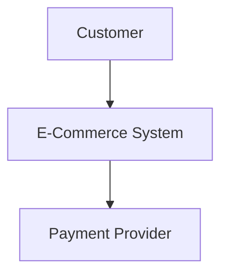
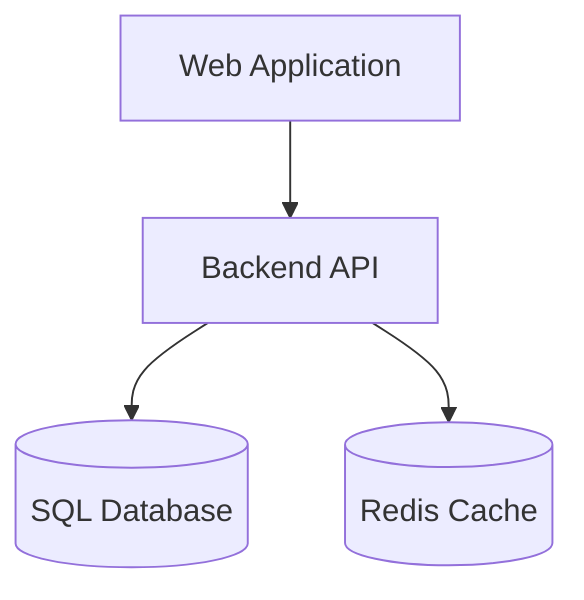
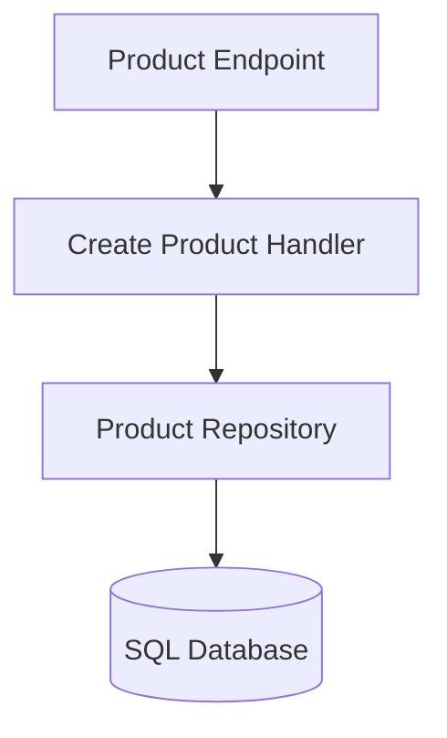
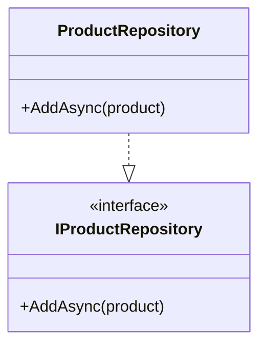

# C4 Model

## What Is It?

The **C4 Model** is a way to visualize software architecture at different levels of detail.

It helps developers understand a system, its components, and how they interact without putting every detail into one diagram.

C4 stands for four levels:

- **Context**
- **Containers**
- **Components**
- **Code**

## 1. System Context Diagram

Shows the system, its users, and the external systems it interacts with.

**Example:** An e-commerce system interacting with customers and an external payment provider.

Use it to understand the system's boundaries and external relationships.

## 2. Container Diagram

Shows the major applications and data stores inside the system.

In the C4 Model, a *container* means an independently runnable or deployable application or data store, not necessarily a Docker container.

Use it to understand the system's high-level technical structure.

## 3. Component Diagram

Shows the major components inside a particular container and their relationships.

Use it when you need to explain the internal structure of an application or a specific feature.

## 4. Code Diagram

Shows the internal design of a component, such as classes, interfaces, and their relationships.

Use it when class-level details are important. You usually do not need to create these diagrams for every part of an application.

## When Is It Useful?

- Understanding an unfamiliar system.
- Communicating architecture with other developers.
- Documenting system boundaries and dependencies.
- Explaining the structure of a large application.
- Helping new developers understand a project.

## Tools

- [Structurizr](https://structurizr.com/) — Create C4 architecture diagrams.
- [Mermaid Live Editor](https://mermaid.live/) — Create diagrams using text.
- [diagrams.net](https://app.diagrams.net/) — Draw diagrams visually.

## Key Takeaway

The C4 Model helps you describe software architecture at different levels, from the overall system down to its internal code structure.

Start with the **System Context** and **Container** diagrams. Add Component and Code diagrams only when they provide useful detail.
